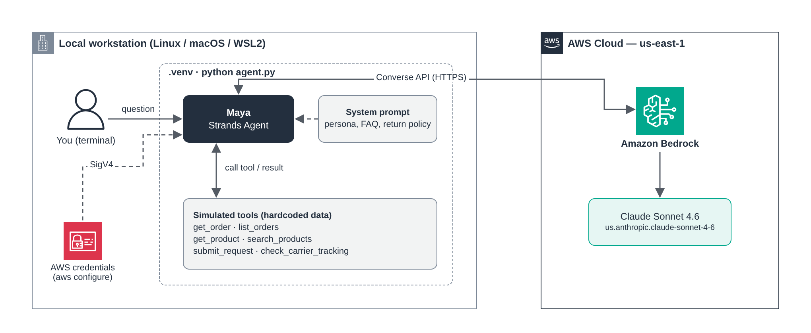
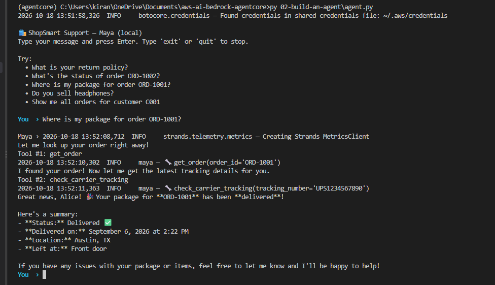

# 02 — Build an Agent

In this module we build our first agent and run it on our own machine. No Runtime, no Gateway, nothing deployed yet. Just a Python file that talks to Claude on Bedrock.

The agent is **Maya**, a customer support assistant for an online store called ShopSmart. She can look up orders, search products, check shipping status and open return requests.

## How it fits together



> Editable source: [`images/local-agent.drawio`](images/local-agent.drawio)

Everything runs on your laptop except the model. When you ask Maya something, the Strands agent sends your question, the system prompt and the list of tools to Bedrock. Claude either answers directly or asks to call a tool. If it asks for a tool, Strands runs that Python function locally, sends the result back, and Claude writes the final reply.

That loop is really all an agent is: **a model, a prompt, and some tools**.

## What's in `agent.py`

- **Model**: Claude Sonnet 4.6 on Bedrock, through the `us.` cross-region inference profile.
- **System prompt**: Maya's tone, how to use the tools, plus the store FAQ and return policy written straight into the prompt.
- **Six tools**: `get_order`, `list_orders`, `get_product`, `search_products`, `submit_request` and `check_carrier_tracking`.

The tools are fake for now. They return hardcoded data, but in the same shape as the real APIs we build later, so swapping them out won't change how Maya behaves.

## Run it

From the repo root, with your virtual environment active (see [00 — Setup](../00-setup/README.md)):

```bash
cd 02-build-an-agent
export AWS_REGION=us-east-1
python agent.py
```

You'll get a prompt in the terminal. Some things to try:

```text
What is your return policy?
What's the status of order ORD-1002?
Where is my package for order ORD-1001?
Do you sell headphones?
Show me all orders for customer C001
I want to return the backpack from ORD-1001, it's too small
```

Type `exit` when you're done.

## Watch the logs

This is the interesting part. Logging is set to INFO, so every time Maya uses a tool you'll see a line like:

```text
🔧 get_order(order_id='ORD-1001')
```

Ask "Where is my package for ORD-1001?" and you'll see her call `get_order` first to find the tracking number, then `check_carrier_tracking` with it. Nobody told her to chain those two calls for that question. She worked it out from the tool descriptions.

Ask the return policy question and you'll see no tool calls at all, because the answer is already in the prompt.

## Local agent execution

Here's a real run. I asked Maya where my package for ORD-1001 is:



You can follow every step in the output:

1. botocore picks up credentials from `~/.aws/credentials`.
2. Maya calls `get_order('ORD-1001')` and gets back the order, including tracking number `UPS1234567890`.
3. She uses that number to call `check_carrier_tracking`.
4. Claude puts the two results together into the final answer: delivered on Sep 6, left at the front door.

Two tool calls, one question, and no hand-written logic telling it to do that.

## Try a different model

You can switch models without touching the code:

```bash
export MAYA_MODEL_ID=us.anthropic.claude-haiku-4-5-20251001-v1:0
python agent.py
```

Haiku is faster and cheaper. It's worth comparing how it handles the multi-step questions.

## What's fake here, and what replaces it

| Right now | Later |
|---|---|
| Agent runs on your laptop | AgentCore **Runtime** |
| FAQ pasted into the prompt | Bedrock **Knowledge Base** |
| Hardcoded order and product data | AgentCore **Gateway** → API Gateway + Lambda |
| Forgets everything when you exit | AgentCore **Memory** |
| Customer ID typed into the chat | AgentCore **Identity** + Cognito |
| Return rules only in the prompt | AgentCore **Policy** |
| Fake carrier tracking | AgentCore **Browser** |

Each of the next modules takes one row from this table and makes it real.

## If something breaks

- **`AccessDeniedException`**: you haven't enabled Claude in the Bedrock console yet, or your user is missing `AmazonBedrockMarketplaceAccess`. Go back to Step 5 in setup.
- **`ValidationException` on the model ID**: your region doesn't match the `us.` profile. Use `us-east-1`.
- **`ModuleNotFoundError: strands`**: the virtual environment isn't active. Run `source .venv/bin/activate`.

---

**Previous:** [01 — AgentCore Overview](../01-agent-overview/README.md) · **Next:** [03 — Deploy to AgentCore Runtime](../03-agentcore-runtime/README.md)
