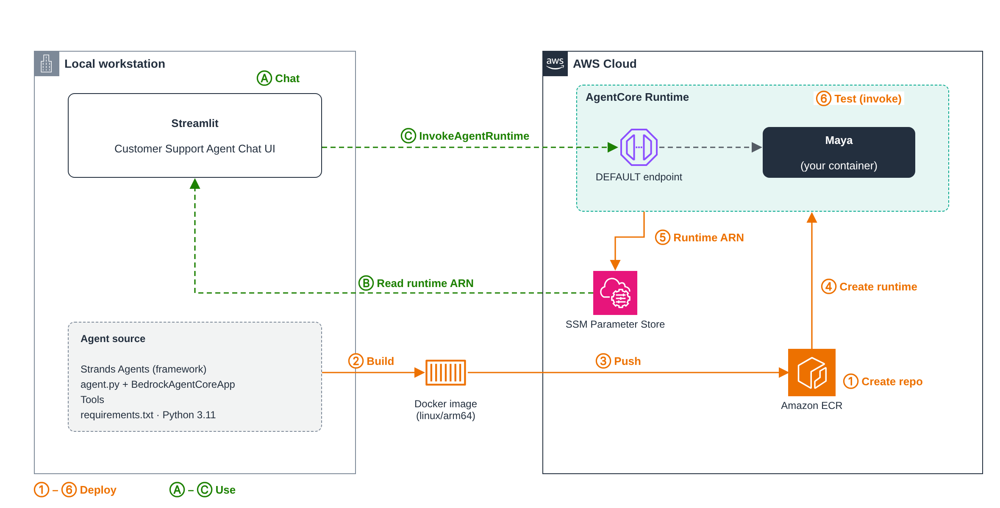

# 03 — Deploy to AgentCore Runtime

In module 02, Maya ran on your laptop. That's fine for trying things out, but nobody else can use her and she stops when you close the terminal.

In this module we put her on **AgentCore Runtime**. We package the agent as a container, push it to ECR, and let AgentCore run it for us. The agent code barely changes. What changes is where it runs.

## The big picture



> Editable source: [`images/deploy-runtime.drawio`](images/deploy-runtime.drawio)

There are two flows in the diagram.

**Deploy (orange, ① to ⑥)** is what you do once, from your workstation:

1. Create an ECR repository to hold the image.
2. Build the agent into a Docker image (ARM64).
3. Push the image to ECR.
4. Create an AgentCore Runtime that points at that image.
5. Save the runtime ARN in SSM Parameter Store.
6. Invoke the runtime to check it works.

**Use (green, Ⓐ to Ⓒ)** is what happens every time someone chats:

- Ⓐ The user types into the Streamlit chat UI.
- Ⓑ The UI reads the runtime ARN from SSM, so nothing is hardcoded.
- Ⓒ The UI calls `InvokeAgentRuntime`. The DEFAULT endpoint routes the request to Maya's container.

## Why Runtime?

- No servers to manage. AgentCore starts the container when a request comes in.
- Each chat session gets its own isolated microVM, so one customer's conversation never leaks into another's.
- Sessions can run for a long time (up to 8 hours), which suits agents that make several slow tool calls.
- You pay for what you use. Idle time while waiting on the LLM isn't billed as CPU.

## What changes in the code

Not much. We wrap the same agent from module 02 in `BedrockAgentCoreApp`, which gives it the HTTP contract Runtime expects (`POST /invocations` and `GET /ping` on port 8080).

```python
from bedrock_agentcore.runtime import BedrockAgentCoreApp

app = BedrockAgentCoreApp()

@app.entrypoint
def invoke(payload):
    prompt = payload.get("prompt", "")
    result = agent(prompt)          # same Strands agent as module 02
    return {"result": str(result)}

if __name__ == "__main__":
    app.run()
```

The CLI chat loop goes away. The model, system prompt and tools all stay the same.

The Dockerfile is short:

```dockerfile
FROM --platform=linux/arm64 python:3.11-slim
WORKDIR /app
COPY requirements.txt .
RUN pip install --no-cache-dir -r requirements.txt
COPY agent.py .
EXPOSE 8080
CMD ["python", "agent.py"]
```

## Before you start

Set a few variables. Every command below uses them.

```bash
export AWS_REGION=us-east-1
export ACCOUNT_ID=$(aws sts get-caller-identity --query Account --output text)
export REPO_NAME=maya-agent
export ECR_URI=$ACCOUNT_ID.dkr.ecr.$AWS_REGION.amazonaws.com/$REPO_NAME
```

Make sure Docker is running. If you're on an x86 machine, register ARM64 emulation once (see [00 — Setup](../00-setup/README.md#docker-notes)).

## ① Create the ECR repository

```bash
aws ecr create-repository --repository-name $REPO_NAME --region $AWS_REGION
```

## ② Build the image

```bash
cd 03-agentcore-runtime
docker buildx build --platform linux/arm64 -t $ECR_URI:latest --load .
```

Before pushing, run it locally and make sure it answers:

```bash
docker run --rm -p 8080:8080 \
  -e AWS_REGION -e AWS_ACCESS_KEY_ID -e AWS_SECRET_ACCESS_KEY -e AWS_SESSION_TOKEN \
  $ECR_URI:latest
```

In a second terminal:

```bash
curl http://localhost:8080/ping
curl -X POST http://localhost:8080/invocations \
  -H "Content-Type: application/json" \
  -d '{"prompt": "What is your return policy?"}'
```

If you get an answer back here, the container is good. Most deployment problems show up at this step, and they're much easier to fix locally.

## ③ Push to ECR

```bash
aws ecr get-login-password --region $AWS_REGION \
  | docker login --username AWS --password-stdin $ACCOUNT_ID.dkr.ecr.$AWS_REGION.amazonaws.com

docker push $ECR_URI:latest
```

## ④ Create the runtime

Runtime needs an IAM role it can assume to pull the image, call Bedrock and write logs. The trust policy lets AgentCore assume it:

```json
{
  "Version": "2012-10-17",
  "Statement": [{
    "Effect": "Allow",
    "Principal": { "Service": "bedrock-agentcore.amazonaws.com" },
    "Action": "sts:AssumeRole"
  }]
}
```

Give the role permission for `ecr:GetAuthorizationToken`, `ecr:BatchGetImage`, `ecr:GetDownloadUrlForLayer`, `bedrock:InvokeModel`, `bedrock:InvokeModelWithResponseStream` and CloudWatch Logs. Then create the runtime:

```bash
export ROLE_ARN=arn:aws:iam::$ACCOUNT_ID:role/<your-agentcore-runtime-role>

aws bedrock-agentcore-control create-agent-runtime \
  --agent-runtime-name maya_agent \
  --agent-runtime-artifact "containerConfiguration={containerUri=$ECR_URI:latest}" \
  --role-arn $ROLE_ARN \
  --network-configuration networkMode=PUBLIC \
  --region $AWS_REGION
```

> The runtime name allows letters, numbers and underscores only. `maya-agent` will be rejected.

The response includes `agentRuntimeArn` and `agentRuntimeId`. Wait for the status to become `READY`:

```bash
aws bedrock-agentcore-control get-agent-runtime \
  --agent-runtime-id <agentRuntimeId> --query status
```

A `DEFAULT` endpoint is created for you automatically.

## ⑤ Save the ARN in Parameter Store

```bash
aws ssm put-parameter \
  --name /maya/agent-runtime-arn \
  --type String \
  --value <agentRuntimeArn> \
  --overwrite
```

From now on, anything that needs to call Maya looks up this parameter instead of carrying the ARN around.

## ⑥ Test it

```python
import boto3, json, uuid

region = "us-east-1"
arn = boto3.client("ssm", region_name=region).get_parameter(
    Name="/maya/agent-runtime-arn")["Parameter"]["Value"]

client = boto3.client("bedrock-agentcore", region_name=region)
resp = client.invoke_agent_runtime(
    agentRuntimeArn=arn,
    runtimeSessionId=str(uuid.uuid4()),   # must be at least 33 characters
    payload=json.dumps({"prompt": "Where is my package for order ORD-1001?"}),
)
print(resp["response"].read().decode())
```

You should get the same answer as in module 02. This time it came from AWS, not your laptop.

Logs go to CloudWatch under `/aws/bedrock-agentcore/runtimes/<agentRuntimeId>-DEFAULT`. The same `🔧 get_order(...)` lines you watched locally show up there.

## Chat with it in Streamlit

```bash
streamlit run streamlit-ui/app.py
```

The UI reads `/maya/agent-runtime-arn` from SSM and calls `InvokeAgentRuntime` for each message. It reuses the same session ID for the whole chat, so every message in a conversation lands in the same microVM.

## Shortcut: the starter toolkit

All of the above can be done with the `bedrock-agentcore-starter-toolkit` CLI (`agentcore configure` then `agentcore launch`). It creates the ECR repo, role and runtime for you. We do it by hand here once so you know what each piece is. Feel free to use the toolkit after that.

## If something breaks

- **`exec format error` in the logs**: the image was built for x86. Rebuild with `--platform linux/arm64`.
- **Runtime stuck in `CREATE_FAILED`**: usually the role. Check the trust policy and the ECR permissions.
- **`AccessDeniedException` calling Bedrock from the runtime**: the role is missing `bedrock:InvokeModel`, or Marketplace access for Claude.
- **`ValidationException` on `runtimeSessionId`**: it's too short. Use a UUID or anything 33+ characters.

## Clean up

```bash
aws bedrock-agentcore-control delete-agent-runtime --agent-runtime-id <agentRuntimeId>
aws ecr delete-repository --repository-name $REPO_NAME --force
aws ssm delete-parameter --name /maya/agent-runtime-arn
```

---

**Previous:** [02 — Build an Agent](../02-build-an-agent/README.md)
