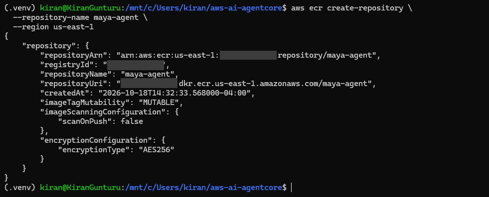
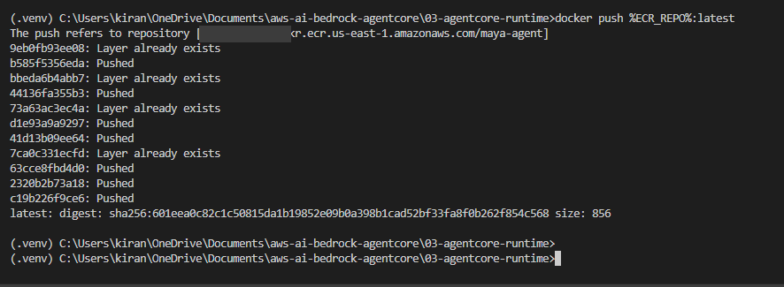
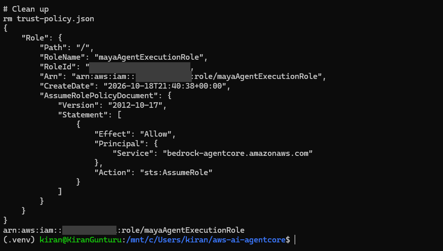
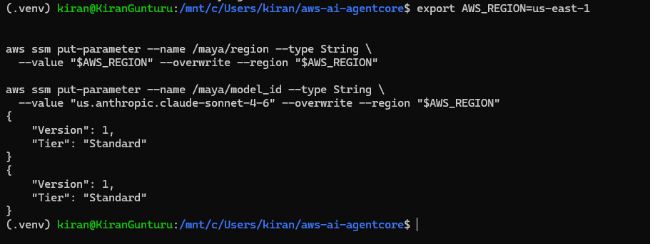
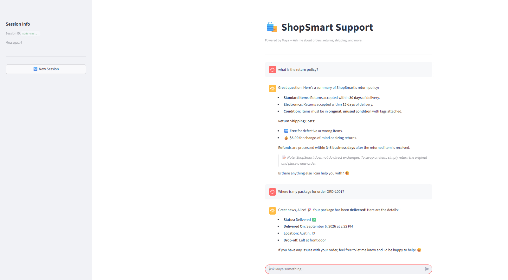

# 03 — Deploy to AgentCore Runtime

In module 02, Maya ran on your laptop. That's fine for trying things out, but nobody else can use her and she stops when you close the terminal.

In this module we put her on **AgentCore Runtime**. We package the agent as a container, push it to ECR, and let AgentCore run it for us. The agent code barely changes. What changes is where it runs.

## The big picture


> Editable source: [`images/deploy-runtime.drawio`](images/deploy-runtime.drawio)

There are two flows in the diagram.

**Deploy (orange, ① to ⑥)** is what you do once, from your workstation:

1. Create an ECR repository to hold the image.
2. Build the agent into a Docker image (ARM64).
3. Push the image to ECR.
4. Create an AgentCore Runtime that points at that image.
5. Save the runtime ARN in SSM Parameter Store.
6. Invoke the runtime to check it works.

**Use (green, Ⓐ to Ⓒ)** is what happens every time someone chats:

- Ⓐ The user types into the Streamlit chat UI.
- Ⓑ The UI reads the runtime ARN from SSM, so nothing is hardcoded.
- Ⓒ The UI calls `InvokeAgentRuntime`. The DEFAULT endpoint routes the request to Maya's container.

## Why Runtime?

- No servers to manage. AgentCore starts the container when a request comes in.
- Each chat session gets its own isolated microVM, so one customer's conversation never leaks into another's.
- Sessions can run for a long time (up to 8 hours), which suits agents that make several slow tool calls.
- You pay for what you use. Idle time while waiting on the LLM isn't billed as CPU.

## What changes in the code

Not much. We wrap the same agent from module 02 in `BedrockAgentCoreApp`, which gives it the HTTP contract Runtime expects (`POST /invocations` and `GET /ping` on port 8080).

```python
from bedrock_agentcore.runtime import BedrockAgentCoreApp

app = BedrockAgentCoreApp()

@app.entrypoint
def invoke(payload):
    prompt = payload.get("prompt", "")
    result = agent(prompt)          # same Strands agent as module 02
    return {"result": str(result)}

if __name__ == "__main__":
    app.run()
```

The CLI chat loop goes away. The model, system prompt and tools all stay the same.

The [Dockerfile](Dockerfile) has two stages:

- **Builder** runs on your own CPU and downloads ready-made ARM64 Python packages (wheels) for everything in `requirements.txt`.
- **Runtime** is the ARM64 image that AgentCore actually runs. It copies those packages in, adds `agent.py` and `config.py`, and starts the agent as a non-root `maya` user on port 8080.

```dockerfile
FROM --platform=$BUILDPLATFORM python:3.11-slim AS builder
WORKDIR /build
COPY requirements.txt .
RUN pip install --no-cache-dir --target=/install --only-binary=:all: \
      --python-version=3.11 --implementation=cp --abi=cp311 \
      --platform=manylinux2014_aarch64 --platform=manylinux_2_28_aarch64 \
      --platform=manylinux_2_34_aarch64 -r requirements.txt

FROM --platform=linux/arm64 python:3.11-slim AS runtime
RUN useradd --create-home --shell /bin/bash maya
WORKDIR /app
COPY --from=builder /install /usr/local/lib/python3.11/site-packages
COPY --chown=maya:maya agent.py config.py ./
USER maya
EXPOSE 8080
CMD ["python", "agent.py"]
```

`config.py` reads `/maya/model_id` and `/maya/region` from Parameter Store when the agent starts, so you can change the model without rebuilding.

## Before you start

You can run this module from **Windows (cmd)** with Docker Desktop, or from **Linux / WSL2 / macOS (bash)**. Every command below has both versions. Pick one and stick with it, because the AWS CLI and Docker on Windows are separate from the ones inside WSL.

### Install Docker

**Windows (Docker Desktop).** Open **Command Prompt as Administrator** and run:

```cmd
wsl --install --no-distribution
winget install -e --id Docker.DockerDesktop
winget install -e --id Amazon.AWSCLI
```

Restart Windows. Then open **Docker Desktop** from the Start menu, accept the terms, and wait until it shows **Engine running**. Docker Desktop already includes buildx and ARM64 emulation, so there's nothing else to install.

**Linux / WSL2 (Docker Engine).** Install Docker Engine (see [00 — Setup](../00-setup/README.md)), then run this once. Run the second line again after every WSL restart:

```bash
sudo apt install -y docker-buildx-plugin                         # or: sudo apt install -y docker-buildx
docker run --privileged --rm tonistiigi/binfmt --install arm64   # lets x86 build ARM64 images
```

### Make sure `docker` is on your PATH

Open a **new** terminal and check:

```cmd
docker version
docker buildx version
```

You should see both a **Client** and a **Server** section. If you don't:

- **`'docker' is not recognized`** (Windows): the terminal was opened before Docker was installed. Close every Command Prompt and VS Code window and open a new one. To fix just the current window:

  ```cmd
  set "PATH=%PATH%;C:\Program Files\Docker\Docker\resources\bin"
  ```

  If new windows still can't find it, add `C:\Program Files\Docker\Docker\resources\bin` under **System Properties → Environment Variables → Path**, or restart Windows.
- **Client shows but Server errors**: the engine isn't running. Start Docker Desktop (Windows) or run `sudo service docker start` (WSL).

### Know which folder you're in

Everything Docker needs is in `03-agentcore-runtime`. **Run the build from inside that folder.** The `.` at the end of the build command means "use the current folder".

```text
aws-ai-bedrock-agentcore/
└── 03-agentcore-runtime/      ← run docker build here
    ├── Dockerfile
    ├── requirements.txt
    ├── agent.py
    ├── config.py
    └── app.py                 (Streamlit UI, runs on your laptop, not in the image)
```

```cmd
cd C:\Users\<you>\OneDrive\Documents\aws-ai-bedrock-agentcore\03-agentcore-runtime
```

```bash
cd ~/aws-ai-bedrock-agentcore/03-agentcore-runtime
```

If you see `failed to read dockerfile` or `open Dockerfile: no such file`, you're in the wrong folder.

### Set your variables

Every command below uses these. Set them in the same terminal you build from.

**Windows cmd**

```cmd
set AWS_REGION=us-east-1
for /f %i in ('aws sts get-caller-identity --query Account --output text') do set "ACCOUNT_ID=%i"
set REPO_NAME=maya-agent
set "ECR_HOST=%ACCOUNT_ID%.dkr.ecr.%AWS_REGION%.amazonaws.com"
set "ECR_URI=%ECR_HOST%/%REPO_NAME%"
echo [%ECR_URI%]
```

The `echo` should print the URI inside the brackets with no spaces. `set` only lasts for that window, so if you open a new one, run these lines again.

**bash**

```bash
export AWS_REGION=us-east-1
export ACCOUNT_ID=$(aws sts get-caller-identity --query Account --output text)
export REPO_NAME=maya-agent
export ECR_HOST=$ACCOUNT_ID.dkr.ecr.$AWS_REGION.amazonaws.com
export ECR_URI=$ECR_HOST/$REPO_NAME
echo $ECR_URI
```

## ① Create the ECR repository

```cmd
aws ecr create-repository --repository-name %REPO_NAME% --region %AWS_REGION%
```

```bash
aws ecr create-repository --repository-name $REPO_NAME --region $AWS_REGION
```

You'll get the repository details back. Note the `repositoryUri`, which is where you push to later.



You only do this once. If the repository already exists, you'll get `RepositoryAlreadyExistsException`, which is fine.

## ② Build the image

AgentCore Runtime runs on **ARM64** (Graviton), so always build with `--platform linux/arm64`, even on an x86 laptop.

From inside `03-agentcore-runtime`:

```cmd
docker buildx build --platform linux/arm64 -t %ECR_URI%:latest --load .
```

```bash
docker buildx build --platform linux/arm64 -t $ECR_URI:latest --load .
```

- `--platform linux/arm64` builds for the CPU AgentCore uses.
- `-t ...:latest` names the image with your ECR address, so it's ready to push.
- `--load` keeps the image in your local Docker so you can test and push it.
- `.` uses the current folder as the build context.

Check that it's there:

```cmd
docker images %REPO_NAME%
```

### Test the container locally (optional, but worth it)

Run the container with your AWS credentials mounted read-only:

```cmd
docker run --rm -p 8080:8080 -e AWS_REGION=%AWS_REGION% -v "%USERPROFILE%\.aws:/home/maya/.aws:ro" %ECR_URI%:latest
```

```bash
docker run --rm -p 8080:8080 -e AWS_REGION -v ~/.aws:/home/maya/.aws:ro $ECR_URI:latest
```

In a second terminal:

```cmd
curl http://localhost:8080/ping
curl -X POST http://localhost:8080/invocations -H "Content-Type: application/json" -d "{\"prompt\": \"What is your return policy?\"}"
```

```bash
curl http://localhost:8080/ping
curl -X POST http://localhost:8080/invocations \
  -H "Content-Type: application/json" \
  -d '{"prompt": "What is your return policy?"}'
```

If Maya answers here, the image is good. Most deployment problems show up at this step, and they're much easier to fix locally. Stop the container with `Ctrl+C`.

## ③ Push to ECR

Log Docker in to your ECR registry, then push. The login lasts 12 hours.

```cmd
aws ecr get-login-password --region %AWS_REGION% | docker login --username AWS --password-stdin %ECR_HOST%
docker push %ECR_URI%:latest
```

```bash
aws ecr get-login-password --region $AWS_REGION | docker login --username AWS --password-stdin $ECR_HOST
docker push $ECR_URI:latest
```

You should see `Login Succeeded`, then each layer being pushed, ending with a `latest: digest: sha256:...` line.



Layers marked `Layer already exists` were already in ECR from an earlier push (the Python base image, for example), so Docker skips them. Only the layers that changed get uploaded.

You can confirm in the console under **ECR → Repositories → maya-agent**, or with:

```cmd
aws ecr describe-images --repository-name %REPO_NAME% --region %AWS_REGION%
```

### Changed the code later?

Build and push again (steps ② and ③), with the same tag. If the runtime already exists, run `update-agent-runtime` with the same container URI so it picks up the new image. Pushing alone doesn't change what's running.

## ④ Create the runtime

Runtime needs an IAM role it can assume to pull the image, call Bedrock and write logs. The trust policy lets AgentCore assume it:

```json
{
  "Version": "2012-10-17",
  "Statement": [{
    "Effect": "Allow",
    "Principal": { "Service": "bedrock-agentcore.amazonaws.com" },
    "Action": "sts:AssumeRole"
  }]
}
```

Give the role permission for `ecr:GetAuthorizationToken`, `ecr:BatchGetImage`, `ecr:GetDownloadUrlForLayer`, `bedrock:InvokeModel`, `bedrock:InvokeModelWithResponseStream` and CloudWatch Logs. Here's the role after creating it with that trust policy:



### Create the runtime in the console

1. Go to **AWS Console → Amazon Bedrock → AgentCore → Runtime → Create agent runtime**.
2. Fill in:
   - **Agent runtime name:** `maya`
   - **Compute:** leave the default, **MicroVM**
   - **Additional details** (expand it): set **Description** to `ShopSmart AI customer support agent`
   - **Agent source:** choose **ECR Container** (not S3 source)
   - **Image URI:** `<your-ecr-repo-uri>:latest`, the same `ECR_URI` you pushed to in step ③
   - **Permissions:** select **Use another role** and pick `mayaAgentExecutionRole`
   - **Environment variables** (under **Advanced configurations**): add `AWS_REGION` = `us-east-1`
3. Click **Create agent runtime**.
4. Wait until the status shows **Ready**.
5. Copy the **Agent Runtime ARN**. You need it in step ⑤.

### Or create it with the CLI (optional)

```bash
export ROLE_ARN=arn:aws:iam::$ACCOUNT_ID:role/mayaAgentExecutionRole

aws bedrock-agentcore-control create-agent-runtime \
  --agent-runtime-name maya \
  --agent-runtime-artifact "containerConfiguration={containerUri=$ECR_URI:latest}" \
  --role-arn $ROLE_ARN \
  --network-configuration networkMode=PUBLIC \
  --region $AWS_REGION
```

> The runtime name allows letters, numbers and underscores only. `maya-agent` will be rejected.

The response includes `agentRuntimeArn` and `agentRuntimeId`. Wait for the status to become `READY`:

```bash
aws bedrock-agentcore-control get-agent-runtime \
  --agent-runtime-id <agentRuntimeId> --query status
```

A `DEFAULT` endpoint is created for you automatically.

## ⑤ Save the ARN in Parameter Store

The Streamlit app uses this parameter to find the agent on AgentCore Runtime and invoke it.

| SSM parameter | Purpose | Value |
|---|---|---|
| `/maya/runtime_arn` | AgentCore Runtime ARN | `arn:aws:bedrock-agentcore:...` (from step ④) |

```cmd
aws ssm put-parameter --name /maya/runtime_arn --type String --value <agentRuntimeArn> --overwrite --region %AWS_REGION%
```

```bash
aws ssm put-parameter --name /maya/runtime_arn --type String \
  --value <agentRuntimeArn> --overwrite --region $AWS_REGION
```

> On Windows, run this from cmd or PowerShell, not Git Bash. Git Bash rewrites `/maya/...` into a Windows path, and SSM fails with *Parameter name must be a fully qualified name*.

From now on, anything that needs to call Maya looks up this parameter instead of carrying the ARN around.

I also keep the region and model ID in Parameter Store, so the agent and the UI read the same settings and you can switch models without rebuilding the image:

```bash
aws ssm put-parameter --name /maya/region --type String \
  --value "$AWS_REGION" --overwrite --region "$AWS_REGION"

aws ssm put-parameter --name /maya/model_id --type String \
  --value "us.anthropic.claude-sonnet-4-6" --overwrite --region "$AWS_REGION"
```



## ⑥ Test it

### In the Runtime console

The quickest check is the built-in **Test** tab:

1. Go to **AWS Console → Amazon Bedrock → AgentCore → Runtime**.
2. Select `maya` and open the **Test** tab.
3. Try these prompts:
   - What is your return policy?
   - What's the status of order ORD-1002?
   - Where is my package for order ORD-1001?

Maya answers just like she did locally in module 02. The FAQ comes from her system prompt, and the order and tracking answers come from the simulated tools.

> The tools are still simulated, so Maya only knows the sample orders (ORD-1001, ORD-1002) and products baked into `agent.py`. Real data comes later, through Gateway.

If something looks wrong, check the CloudWatch logs (below).

### From Python

```python
import boto3, json, uuid

region = "us-east-1"
arn = boto3.client("ssm", region_name=region).get_parameter(
    Name="/maya/runtime_arn")["Parameter"]["Value"]

client = boto3.client("bedrock-agentcore", region_name=region)
resp = client.invoke_agent_runtime(
    agentRuntimeArn=arn,
    runtimeSessionId=str(uuid.uuid4()),   # must be at least 33 characters
    payload=json.dumps({"prompt": "Where is my package for order ORD-1001?"}),
)
print(resp["response"].read().decode())
```

You should get the same answer as in module 02. This time it came from AWS, not your laptop.

Logs go to CloudWatch under `/aws/bedrock-agentcore/runtimes/<agentRuntimeId>-DEFAULT`. The same `🔧 get_order(...)` lines you watched locally show up there.

## Chat with it in Streamlit

This is the same chat screen a customer would use. From the repo root, with your virtual environment active:

```cmd
set AWS_REGION=us-east-1
streamlit run 03-agentcore-runtime\app.py
```

```bash
export AWS_REGION=us-east-1
streamlit run 03-agentcore-runtime/app.py
```

It opens at `http://localhost:8501`.

The UI reads `/maya/runtime_arn` from SSM and calls `InvokeAgentRuntime` for each message. It reuses the same session ID for the whole chat, so every message in a conversation lands in the same microVM.



Same answers as the local run in module 02. The difference is that this time every reply comes from the container running on AgentCore Runtime. **New Session** in the sidebar starts a fresh session ID, which means a fresh microVM.

## Shortcut: the starter toolkit

All of the above can be done with the `bedrock-agentcore-starter-toolkit` CLI (`agentcore configure` then `agentcore launch`). It creates the ECR repo, role and runtime for you. We do it by hand here once so you know what each piece is. Feel free to use the toolkit after that.

## If something breaks

- **`exec /bin/sh: exec format error` during `docker build`**: you're building an ARM64 image on an x86 machine without emulation. You'll usually also see `DEPRECATED: The legacy builder is deprecated` and `The requested image's platform (linux/arm64) does not match the detected host platform (linux/amd64)`. Run `docker run --privileged --rm tonistiigi/binfmt --install arm64`, make sure buildx is installed, and build with `docker buildx build --platform linux/arm64 ...`.
- **`'docker' is not recognized` on Windows**: Docker Desktop is installed but this window was opened before the install. Close every terminal (and VS Code) and open a new one, or for now run `set "PATH=%PATH%;C:\Program Files\Docker\Docker\resources\bin"`.
- **`unknown command: docker buildx`**: buildx isn't installed. Docker Desktop has it; on Linux/WSL2 install `docker-buildx-plugin` or `docker-buildx`.
- **`failed to read dockerfile` / `no such file`**: you're not inside `03-agentcore-runtime`. `cd` into it and build again.
- **`no basic auth credentials` or `denied` on `docker push`**: you're not logged in to ECR, or the login expired after 12 hours. Run the `aws ecr get-login-password ... | docker login ...` line again.
- **`tag does not exist` on `docker push`**: the build failed earlier or used a different tag, so there's no image to push. Check `docker images` and fix the build first.
- **`exec format error` in the runtime logs**: the image was built for x86. Rebuild with `--platform linux/arm64`.
- **Runtime stuck in `CREATE_FAILED`**: usually the role. Check the trust policy and the ECR permissions.
- **`AccessDeniedException` calling Bedrock from the runtime**: the role is missing `bedrock:InvokeModel`, or Marketplace access for Claude.
- **`ValidationException` on `runtimeSessionId`**: it's too short. Use a UUID or anything 33+ characters.

## Clean up

```bash
aws bedrock-agentcore-control delete-agent-runtime --agent-runtime-id <agentRuntimeId>
aws ecr delete-repository --repository-name $REPO_NAME --force
aws ssm delete-parameter --name /maya/runtime_arn
```

---

**Previous:** [02 — Build an Agent](../02-build-an-agent/README.md) · **Next:** [04 — Knowledge Base](../04-knowledge-base/README.md)
