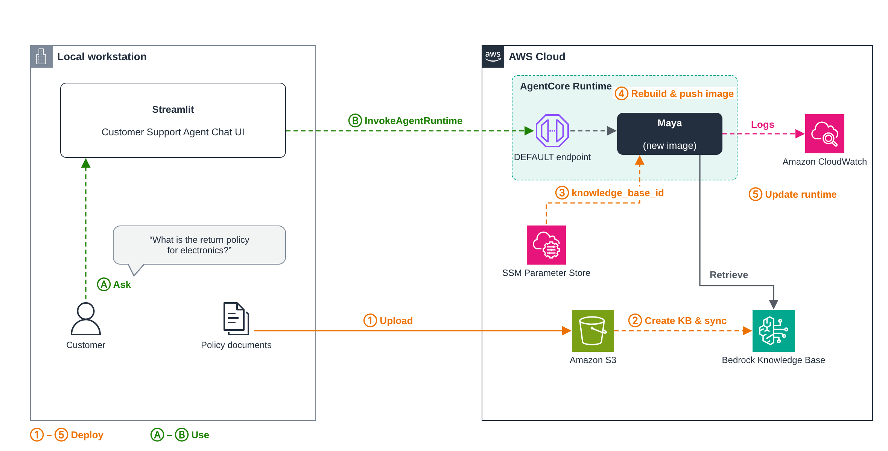

# 04 — Knowledge Base

In module 03, Maya's FAQ (return policy, shipping, payments) was pasted straight into her system prompt. That works for a demo, but every policy change means editing code, rebuilding the image and redeploying.

In this module we move that knowledge out of the prompt and into an **AgentCore Knowledge Base**. The policy documents live in S3, the Knowledge Base indexes them, and Maya looks things up with a new tool whenever a customer asks a policy question. To change a policy, you update the document and sync. The agent stays the same.

## The big picture



> Editable source: [`images/knowledge-base.drawio`](images/knowledge-base.drawio)

**Deploy (orange, ① to ⑤):**

1. Upload the policy documents to S3.
2. Create the Knowledge Base on top of that bucket and sync it.
3. Save the Knowledge Base ID in SSM Parameter Store.
4. Rebuild the agent image and push it to ECR.
5. Update the runtime so it runs the new image.

**Use (green, Ⓐ to Ⓑ):**

- Ⓐ A customer asks a policy question, like *"What is the return policy for electronics?"*
- Ⓑ The chat UI calls the runtime. Maya calls `retrieve_from_knowledge_base`, gets the matching chunks back and answers from them. Her logs go to CloudWatch as before.

## What changes in the code

Only one thing: a new tool.

```python
@tool
def retrieve_from_knowledge_base(query: str) -> str:
    """Retrieve relevant information from the ShopSmart knowledge base.
    Use this tool to answer questions about return policy, shipping,
    payment methods, store hours, and general FAQs."""
    response = bedrock_agent_runtime.retrieve(
        knowledgeBaseId=cfg.knowledge_base_id,
        retrievalQuery={"text": query},
        retrievalConfiguration={
            "managedSearchConfiguration": {"numberOfResults": cfg.kb_num_results}
        },
    )
    ...
```

- The FAQ is gone from the system prompt. In its place, the prompt tells Maya to *always* use this tool for policy questions rather than answering from memory.
- `managedSearchConfiguration` is what you use with a **managed** knowledge base. A classic vector-store knowledge base uses `vectorSearchConfiguration` instead.
- The order, product and tracking tools are unchanged and still simulated.
- `config.py` now also reads `/maya/knowledge_base_id` and `/maya/kb_num_results` from Parameter Store.

| File | What it is |
|---|---|
| `agent.py` | Maya plus the new Knowledge Base tool |
| `config.py` | Loads model, region, KB ID and result count from SSM |
| `Dockerfile` | Same two-stage ARM64 build as module 03 |
| `requirements.txt` | Same dependencies as module 03 |
| `app.py` | Streamlit chat UI (runs on your laptop) |

## Before you start

You need module 03 working: the ECR repo `maya-agent`, the `maya` runtime and the `mayaAgentExecutionRole` role. Open a terminal, activate the venv and set your variables again (see [module 03](../03-agentcore-runtime/README.md#set-your-variables)):

```cmd
cd C:\Users\<you>\OneDrive\Documents\aws-ai-bedrock-agentcore
.venv\Scripts\activate
set AWS_REGION=us-east-1
for /f %i in ('aws sts get-caller-identity --query Account --output text') do set "ACCOUNT_ID=%i"
set "ECR_HOST=%ACCOUNT_ID%.dkr.ecr.%AWS_REGION%.amazonaws.com"
set "ECR_URI=%ECR_HOST%/maya-agent"
set "KB_BUCKET=maya-kb-docs-%ACCOUNT_ID%"
```

```bash
export AWS_REGION=us-east-1
export ACCOUNT_ID=$(aws sts get-caller-identity --query Account --output text)
export ECR_HOST=$ACCOUNT_ID.dkr.ecr.$AWS_REGION.amazonaws.com
export ECR_URI=$ECR_HOST/maya-agent
export KB_BUCKET=maya-kb-docs-$ACCOUNT_ID
```

Bucket names are global, so the account ID on the end keeps yours unique.

## ① Upload the policy documents to S3

You need ShopSmart's policy documents: returns, shipping, payments, store hours and general FAQ. Plain `.md`, `.txt`, `.pdf` or `.docx` all work. Put them in a folder, for example `04-knowledge-base\kb-docs\`, then:

```cmd
aws s3 mb s3://%KB_BUCKET% --region %AWS_REGION%
aws s3 sync 04-knowledge-base\kb-docs s3://%KB_BUCKET%/ --region %AWS_REGION%
aws s3 ls s3://%KB_BUCKET%/
```

```bash
aws s3 mb s3://$KB_BUCKET --region $AWS_REGION
aws s3 sync 04-knowledge-base/kb-docs s3://$KB_BUCKET/ --region $AWS_REGION
aws s3 ls s3://$KB_BUCKET/
```

## ② Create the Knowledge Base and sync it

1. Go to **AWS Console → Amazon Bedrock AgentCore → Built-in tools → Knowledge Base**.
2. Choose **Create Managed Knowledge Base**.
3. **Knowledge Base details:** name it `maya-kb`. Under **Additional configurations**:
   - **Description:** `ShopSmart policies and FAQ`
   - **Embedding model:** leave it on **Managed**
   - **IAM permissions:** **Create and use a new service role**
4. **Data source:** name it `maya-kb-s3`, choose **Amazon S3** and pick your `maya-kb-docs-...` bucket.
5. Leave **Content parsing and chunking** on the defaults (**Managed parser**, **Default chunking**).
6. Choose **Create Knowledge Base** and wait 2–5 minutes.
7. Open the data source and click **Sync**. Wait until it shows the documents as indexed.
8. Copy the **Knowledge Base ID**. It's a short code like `ABCDEFGHIJ`.

"Managed" means AgentCore looks after the embeddings, the vector store and the search for you, so there's no OpenSearch or vector database to set up.

> Edited a document later? Upload it to S3 again and click **Sync**. Maya sees the change on the next question, with no rebuild needed.

## ③ Save the Knowledge Base ID and give Maya access

### Parameter Store

| SSM parameter | Purpose | Value |
|---|---|---|
| `/maya/knowledge_base_id` | Which KB Maya searches | your Knowledge Base ID |
| `/maya/kb_num_results` | How many chunks to pull back per question | `5` |

```cmd
aws ssm put-parameter --name /maya/knowledge_base_id --type String --value <your-kb-id> --overwrite --region %AWS_REGION%
aws ssm put-parameter --name /maya/kb_num_results --type String --value 5 --overwrite --region %AWS_REGION%
```

```bash
aws ssm put-parameter --name /maya/knowledge_base_id --type String --value <your-kb-id> --overwrite --region $AWS_REGION
aws ssm put-parameter --name /maya/kb_num_results --type String --value 5 --overwrite --region $AWS_REGION
```

`/maya/model_id` and `/maya/region` are already there from module 03.

> On Windows, run these from cmd or PowerShell, not Git Bash. Git Bash rewrites `/maya/...` into a Windows path.

### Let the runtime role call the Knowledge Base

Maya's runtime runs as `mayaAgentExecutionRole`. That role now needs `bedrock:Retrieve` on the Knowledge Base:

1. Go to **IAM → Roles → mayaAgentExecutionRole → Add permissions → Create inline policy**.
2. Switch to **JSON** and paste in the following, with your region, account ID and KB ID filled in:

```json
{
  "Version": "2012-10-17",
  "Statement": [{
    "Effect": "Allow",
    "Action": "bedrock:Retrieve",
    "Resource": "arn:aws:bedrock:us-east-1:<account-id>:knowledge-base/<your-kb-id>"
  }]
}
```

3. Name it `maya-kb-retrieve` and save.

Skip this and Maya will answer every policy question with *"Knowledge base retrieval is currently unavailable."*

## ④ Rebuild and push the image

Same commands as module 03, but run from the **`04-knowledge-base`** folder, since that's where the new `agent.py` lives:

```cmd
cd 04-knowledge-base
aws ecr get-login-password --region %AWS_REGION% | docker login --username AWS --password-stdin %ECR_HOST%
docker buildx build --platform linux/arm64 -t %ECR_URI%:latest --load .
docker push %ECR_URI%:latest
```

```bash
cd 04-knowledge-base
aws ecr get-login-password --region $AWS_REGION | docker login --username AWS --password-stdin $ECR_HOST
docker buildx build --platform linux/arm64 -t $ECR_URI:latest --load .
docker push $ECR_URI:latest
```

We reuse the same ECR repo and the same `latest` tag. The image is new, but the address is the same.

## ⑤ Update the runtime

Pushing a new image doesn't change what's running. You have to tell the runtime to pick it up.

**Console:**

1. Go to **Amazon Bedrock AgentCore → Runtime** and select `maya`.
2. Choose **Update** (edit), keep the same image URI (`...maya-agent:latest`), the same role and the same `AWS_REGION` variable.
3. Save, and wait until the status is **Ready** again.

This creates a new runtime **version**. The `DEFAULT` endpoint moves to it automatically, so the ARN in `/maya/runtime_arn` doesn't change and the Streamlit app needs no changes.

**CLI (optional):**

```bash
aws bedrock-agentcore-control update-agent-runtime \
  --agent-runtime-id <agentRuntimeId> \
  --agent-runtime-artifact "containerConfiguration={containerUri=$ECR_URI:latest}" \
  --role-arn arn:aws:iam::$ACCOUNT_ID:role/mayaAgentExecutionRole \
  --network-configuration networkMode=PUBLIC \
  --region $AWS_REGION
```

## Test it

### Runtime console

Go to **Runtime → maya → Test** and try:

- What is the return policy for electronics?
- Do you ship internationally?
- Which payment methods do you accept?
- Where is my package for order ORD-1001?

The first three should now come from the Knowledge Base. The last one still uses the simulated order tools.

### Check it really used the Knowledge Base

Open the runtime's CloudWatch logs (`/aws/bedrock-agentcore/runtimes/<agentRuntimeId>-DEFAULT`). For policy questions you should see:

```text
🔧 retrieve_from_knowledge_base(query='return policy for electronics')
```

Seeing that line means the answer came from your documents, not from the model's memory.

### Streamlit

From the repo root:

```cmd
streamlit run 04-knowledge-base\app.py
```

```bash
streamlit run 04-knowledge-base/app.py
```

It's the same chat UI and the same runtime ARN as module 03. Only Maya's behind-the-scenes source of truth has changed.

## If something breaks

- **"Knowledge base not configured."**: `/maya/knowledge_base_id` isn't set, or the parameter name is wrong. Fix it, then start a **new session**. Config is read when the agent starts, so an open session keeps the old value.
- **"Knowledge base retrieval is currently unavailable."**: usually `AccessDeniedException` because the runtime role is missing `bedrock:Retrieve`. Check CloudWatch for the exact error.
- **"No relevant information found in the knowledge base."**: the data source hasn't been synced, or the sync failed. Check the sync status on the data source.
- **Maya still answers with the old behaviour**: the runtime wasn't updated after the push (step ⑤), or you're still in an old chat session. Click **New Session**.

## Clean up

When you're done with the course:

```bash
# delete the Knowledge Base (and its data source) in the console: AgentCore → Knowledge Base → maya-kb → Delete
aws s3 rb s3://$KB_BUCKET --force
aws ssm delete-parameter --name /maya/knowledge_base_id
aws ssm delete-parameter --name /maya/kb_num_results
```

---

**Previous:** [03 — Deploy to AgentCore Runtime](../03-agentcore-runtime/README.md) · **Next:** [05 — AgentCore Gateway](../05-agentcore-gateway/README.md)
