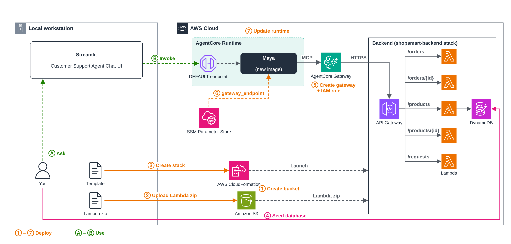

# 05 — AgentCore Gateway

Up to now, Maya's order, product and tracking tools were fake. They returned hardcoded data from inside `agent.py`. In this module they become real.

We deploy a small ShopSmart backend (API Gateway, Lambda and DynamoDB) and put **AgentCore Gateway** in front of it. Gateway takes the backend's REST API and exposes it to Maya as MCP tools. Maya no longer has tool code of her own for orders and products. She connects to the Gateway, finds out what tools are available, and calls them.

## The big picture

> Editable source: [`images/agentcore-gateway.drawio`](images/agentcore-gateway.drawio)

**Deploy (orange, ① to ⑦):**

1. **Create an S3 bucket** to hold the Lambda code.
2. **Upload the Lambda code** (zipped) from [`shopsmar-backend/lambdas`](../shopsmar-backend/lambdas) to that bucket.
3. **Create the CloudFormation stack** from [`shopsmart-backend.yaml`](../shopsmar-backend/cloudformation/shopsmart-backend.yaml). It launches the whole backend: DynamoDB tables, five Lambda functions and an API Gateway with `/orders`, `/orders/{id}`, `/products`, `/products/{id}` and `/requests`.
4. **Seed the database** with sample customers, orders and products (`seed_data.py`).
5. **Create the AgentCore Gateway** and its IAM role. The Gateway points at the API using the OpenAPI spec in [`shopsmart-api.yml`](shopsmart-api.yml), so every API route becomes a tool.
6. **Save the Gateway endpoint** in Parameter Store as `/maya/gateway_endpoint`.
7. **Update the runtime** with the new Maya image, which talks to the Gateway instead of using simulated tools.

**Use (green, Ⓐ to Ⓑ):**

- Ⓐ You ask Maya something in the chat UI, like *"What's the status of order ORD-1002?"*
- Ⓑ The UI invokes the runtime as before. Maya calls a tool on the Gateway over **MCP**. The Gateway turns that into an **HTTPS** call to API Gateway, which runs the matching Lambda, which reads DynamoDB. The answer comes back the same way.

## Why Gateway?

- **Tools live outside the agent.** Add a route to the API and spec, and Maya can use it without a code change or rebuild.
- **No API keys anywhere.** The backend API only accepts IAM-signed requests. The Gateway signs them with its own IAM role, and Maya signs her calls to the Gateway with her runtime role.
- **Standard protocol.** Any MCP-capable agent can use the same Gateway, not just this one.
- **Room to grow.** Policy and observability attach to the Gateway later without touching Maya's code.

Policy questions (returns, shipping, payments) still go to the Knowledge Base from module 04.

---

*Step-by-step instructions coming next.*

---

**Previous:** [04 — Knowledge Base](../04-knowledge-base/README.md)
