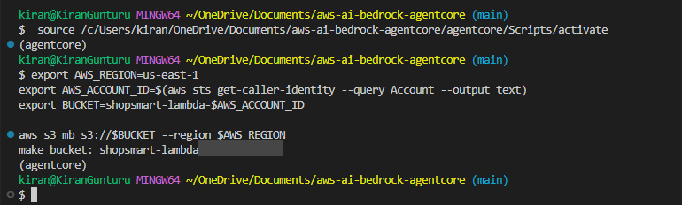
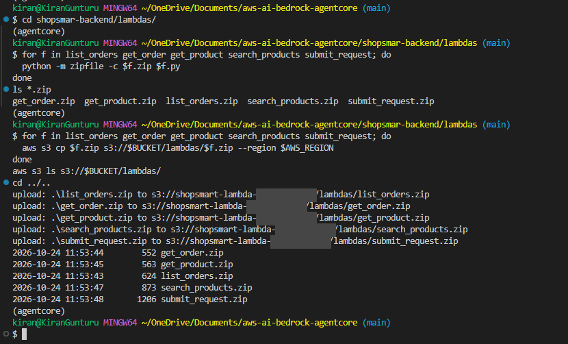
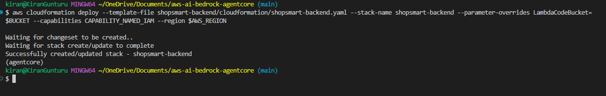
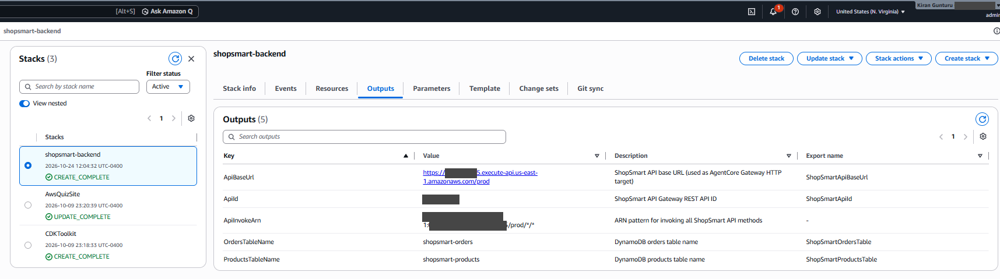
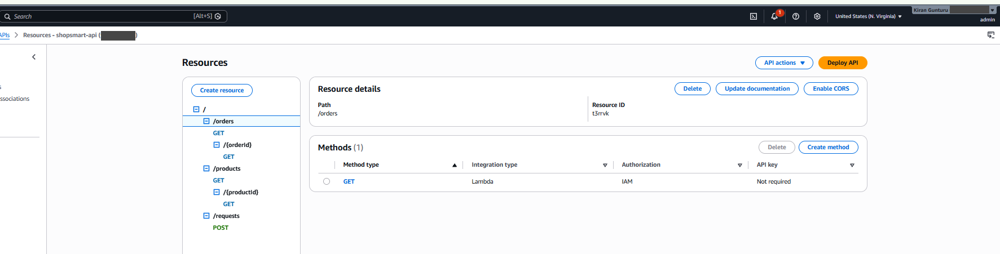
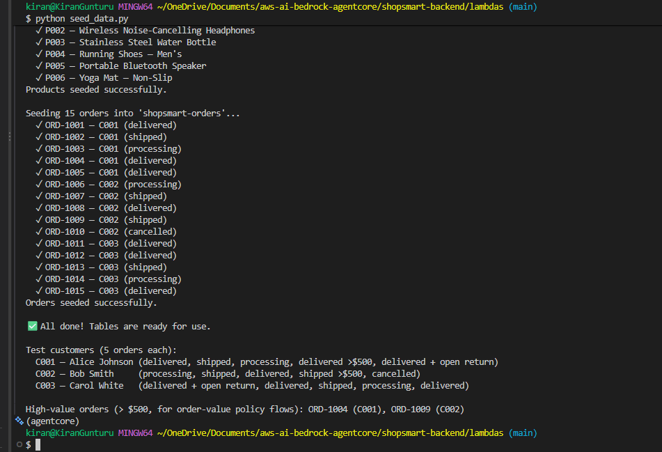
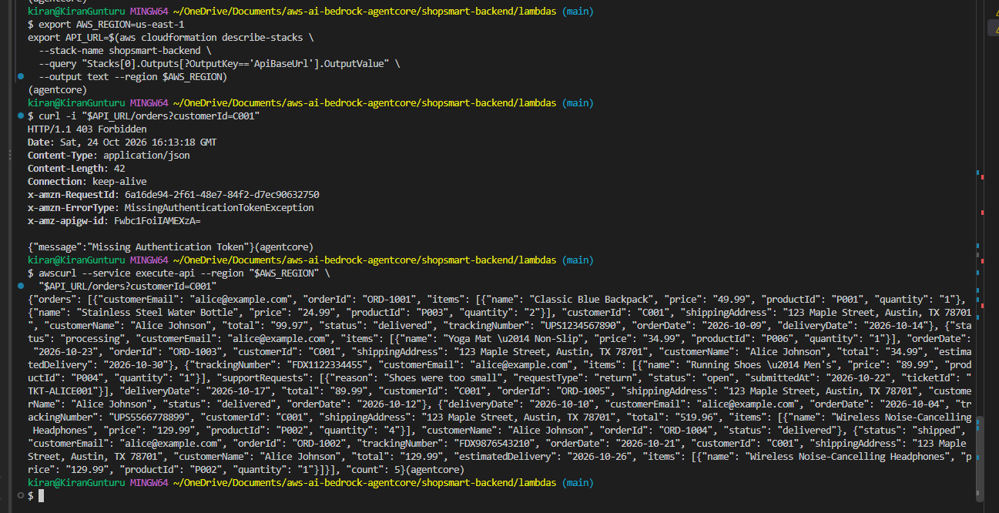

# 05 — AgentCore Gateway

Up to now, Maya's order, product and tracking tools were fake. They returned hardcoded data from inside `agent.py`. In this module they become real.

We deploy a small ShopSmart backend (API Gateway, Lambda and DynamoDB) and put **AgentCore Gateway** in front of it. Gateway takes the backend's REST API and exposes it to Maya as MCP tools. Maya no longer has tool code of her own for orders and products. She connects to the Gateway, finds out what tools are available, and calls them.

## What you'll build

```text
maya (AgentCore Runtime)
    │  discovers + calls tools via MCP
    ▼
AgentCore Gateway
    │  routes to an HTTP target using the OpenAPI spec
    ▼
ShopSmart REST API (API Gateway)
    ├── GET  /orders          → list_orders Lambda     → DynamoDB
    ├── GET  /orders/{id}     → get_order Lambda       → DynamoDB
    ├── GET  /products        → search_products Lambda → DynamoDB
    ├── GET  /products/{id}   → get_product Lambda     → DynamoDB
    └── POST /requests        → submit_request Lambda  → DynamoDB
```

The API Gateway methods require `AWS_IAM`. AgentCore Gateway signs its outbound requests with SigV4 using its Gateway service role, and the Runtime role authenticates the Runtime-to-Gateway connection.

## The big picture


> Editable source: [`images/agentcore-gateway.drawio`](images/agentcore-gateway.drawio)

**Deploy (orange, ① to ⑦):**

1. **Create an S3 bucket** to hold the Lambda code.
2. **Upload the Lambda code** (zipped) from [`shopsmart-backend/lambdas`](../shopsmart-backend/lambdas) to that bucket.
3. **Create the CloudFormation stack** from [`shopsmart-backend.yaml`](../shopsmart-backend/cloudformation/shopsmart-backend.yaml). It launches the whole backend: DynamoDB tables, five Lambda functions and an API Gateway with `/orders`, `/orders/{id}`, `/products`, `/products/{id}` and `/requests`.
4. **Seed the database** with sample customers, orders and products (`seed_data.py`).
5. **Create the AgentCore Gateway** and its IAM role. The Gateway points at the API using the OpenAPI spec in [`shopsmart-api.yml`](shopsmart-api.yml), so every API route becomes a tool.
6. **Save the Gateway endpoint** in Parameter Store as `/maya/gateway_endpoint`.
7. **Update the runtime** with the new Maya image, which talks to the Gateway instead of using simulated tools.

**Use (green, Ⓐ to Ⓑ):**

- Ⓐ You ask Maya something in the chat UI, like *"What's the status of order ORD-1002?"*
- Ⓑ The UI invokes the runtime as before. Maya calls a tool on the Gateway over **MCP**. The Gateway turns that into an **HTTPS** call to API Gateway, which runs the matching Lambda, which reads DynamoDB. The answer comes back the same way.

## Why Gateway?

- **Tools live outside the agent.** Add a route to the API and spec, and Maya can use it without a code change or rebuild.
- **No API keys anywhere.** The backend API only accepts IAM-signed requests. The Gateway signs them with its own IAM role, and Maya signs her calls to the Gateway with her runtime role.
- **Standard protocol.** Any MCP-capable agent can use the same Gateway, not just this one.
- **Room to grow.** Policy and observability attach to the Gateway later without touching Maya's code.

Policy questions (returns, shipping, payments) still go to the Knowledge Base from module 04.

## How this differs from module 04

| | Module 04 — Knowledge Base | Module 05 — Gateway |
|---|---|---|
| Knowledge source | Knowledge Base | Knowledge Base + live backend |
| Order lookup | Simulated (hardcoded sample) | Real DynamoDB orders |
| Product search | Simulated (hardcoded sample) | Real DynamoDB products |
| Return requests | Simulated (fake ticket) | Submitted through the REST API |
| Tool routing | Tools defined in agent code | AgentCore Gateway (MCP) |
| Policy ready | No | Yes — the Gateway is the hook |

---

## Before you start

These steps use **bash**. On Windows, use a **Git Bash** terminal in VS Code (click **⌄** next to **+** in the terminal panel, then **Git Bash**).

Git Bash has two quirks, so run this once per terminal:

```bash
export MSYS_NO_PATHCONV=1    # stops Git Bash rewriting /maya/... SSM names into Windows paths
```

The other quirk is that Git Bash has no `zip` command. We use Python to make the zips instead.

Activate the venv and set your variables. Run this from the repo root:

```bash
source .venv/Scripts/activate        # Windows/Git Bash. On Linux/macOS: source .venv/bin/activate
export AWS_REGION=us-east-1
export AWS_ACCOUNT_ID=$(aws sts get-caller-identity --query Account --output text | tr -d '\r')
export BUCKET=shopsmart-lambda-$AWS_ACCOUNT_ID
echo "[$AWS_REGION] [$BUCKET]"
```

The `echo` should show both values. Variables only last for the current terminal, so if you open a new one, set them again.

## ① Create the S3 bucket

The bucket holds the Lambda code so CloudFormation can pick it up.

```bash
aws s3 mb s3://$BUCKET --region $AWS_REGION
```



## ② Zip and upload the Lambda code

Each Lambda is a single Python file. The template expects one zip per function under `lambdas/`.

```bash
cd shopsmart-backend/lambdas

for f in list_orders get_order get_product search_products submit_request; do
  python -m zipfile -c $f.zip $f.py
done
ls *.zip

for f in list_orders get_order get_product search_products submit_request; do
  aws s3 cp $f.zip s3://$BUCKET/lambdas/$f.zip --region $AWS_REGION
done
aws s3 ls s3://$BUCKET/lambdas/

cd ../..
```



## ③ Create the backend stack

From the repo root, run this as **one line**:

```bash
aws cloudformation deploy --template-file shopsmart-backend/cloudformation/shopsmart-backend.yaml --stack-name shopsmart-backend --parameter-overrides LambdaCodeBucket=$BUCKET --capabilities CAPABILITY_NAMED_IAM --region $AWS_REGION
```

It takes a couple of minutes and ends with `Successfully created/updated stack`.



The stack creates:

- two DynamoDB tables, `shopsmart-orders` and `shopsmart-products`
- an IAM role for the Lambdas
- five Lambda functions (Python 3.11)
- a REST API called `shopsmart-api` with a `prod` stage

Open **CloudFormation → shopsmart-backend → Outputs** to see what it built. **`ApiBaseUrl`** is the one you need later for the Gateway.



In **API Gateway → shopsmart-api → Resources** you can see the five routes. Every method has **Authorization: IAM**, so unsigned requests are rejected.



## ④ Seed the database

The tables start empty. `seed_data.py` adds 6 products and 15 orders across three test customers.

```bash
cd shopsmart-backend/lambdas
python seed_data.py
cd ../..
```



The test customers are worth remembering. You'll use them when you chat with Maya:

| Customer | Name | Orders |
|---|---|---|
| `C001` | Alice Johnson | ORD-1001 to ORD-1005 |
| `C002` | Bob Smith | ORD-1006 to ORD-1010 |
| `C003` | Carol White | ORD-1011 to ORD-1015 |

`ORD-1004` and `ORD-1009` are over $500, which comes in handy when we add policies later.

## Check the API works

Grab the base URL from the stack outputs:

```bash
export API_URL=$(aws cloudformation describe-stacks --stack-name shopsmart-backend --query "Stacks[0].Outputs[?OutputKey=='ApiBaseUrl'].OutputValue" --output text --region $AWS_REGION | tr -d '\r')
echo $API_URL
```

First, a plain `curl`. This **should fail** with `403 Missing Authentication Token`, which proves the API only accepts signed requests:

```bash
curl -i "$API_URL/orders?customerId=C001"
```

Now the same call signed with your AWS credentials, using `awscurl`:

```bash
awscurl --service execute-api --region "$AWS_REGION" "$API_URL/orders?customerId=C001"
```

You should get Alice's five orders back as JSON.



That's the backend done. AgentCore Gateway will make the same signed calls on Maya's behalf.

---

*Steps ⑤ to ⑦ (create the Gateway, save the endpoint, update the runtime) coming next.*

---

**Previous:** [04 — Knowledge Base](../04-knowledge-base/README.md)
