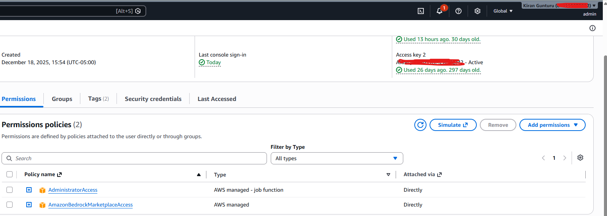
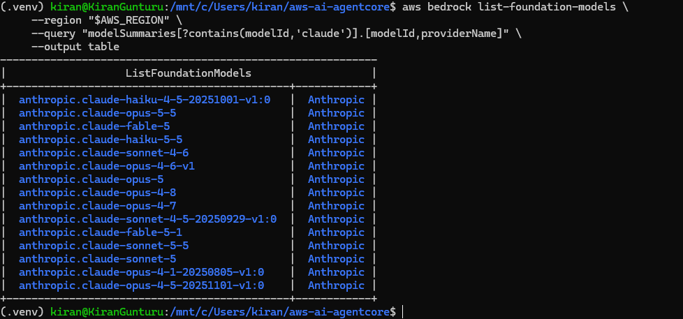
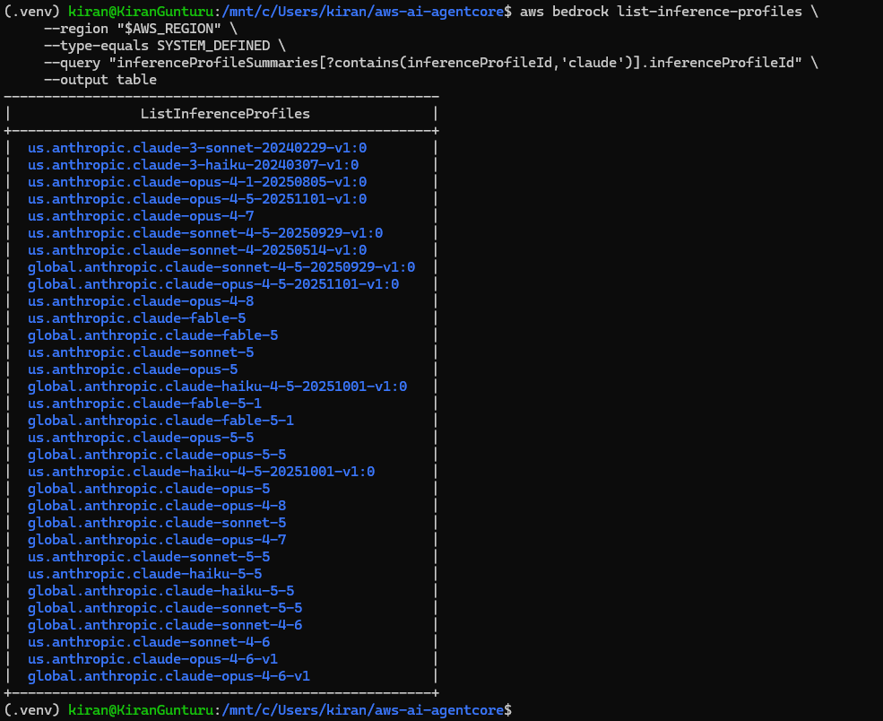

# Module 00 — Prerequisites

Set up your AWS identity, local workstation, and tooling before starting the AgentCore course.

## Contents

1. [AWS Account and Permissions](#1-aws-account-and-permissions)
2. [Local Workstation](#2-local-workstation)
3. [Required Tools](#3-required-tools)
   - [Step 1 — Clone the repository](#step-1--clone-the-repository)
   - [Step 2 — Install the required tools](#step-2--install-the-required-tools)
   - [Step 3 — Activate the Python environment](#step-3--activate-the-python-environment)
   - [Step 4 — AWS IAM user and CLI](#step-4--aws-iam-user-and-cli)
   - [Step 5 — Confirm Bedrock model access](#step-5--confirm-bedrock-model-access)
   - [Step 6 — Verify the complete setup](#step-6--verify-the-complete-setup)
4. [Setup Checklist](#setup-checklist)
5. [Troubleshooting](#troubleshooting)

---

## 1. AWS Account and Permissions

Your IAM identity needs two things:

| Permission | Policy | When needed |
|---|---|---|
| Create course resources | `AdministratorAccess` | Always. Simplest for learning; for a shared or production account, use a dedicated least-privilege identity instead. |
| Access Bedrock Marketplace models | `AmazonBedrockMarketplaceAccess` | Only for Marketplace models such as **Anthropic Claude**. |

> [!NOTE]
> If you use Amazon-provided models (e.g. **Amazon Nova Lite**), you can skip `AmazonBedrockMarketplaceAccess`. The course codebase uses an Anthropic model by default — if you switch, update the model ID accordingly during implementation.

> [!WARNING]
> Never commit access keys or place them in the repository.

Your IAM user (or role) should have **both** `AdministratorAccess` and `AmazonBedrockMarketplaceAccess` attached:



---

## 2. Local Workstation

Supported setups:

| OS | Notes |
|---|---|
| **Linux** | Ubuntu/Debian, or Amazon Linux / RHEL-like distributions |
| **macOS** | Intel or Apple Silicon |
| **Windows** | WSL2 with Ubuntu (recommended). Run all commands from the **WSL2 terminal**, not Windows PowerShell. |

**Windows users** — install WSL2 from an elevated PowerShell prompt:

```powershell
wsl --install -d Ubuntu --name "<name-of-your-vm>"
```

Connect to your VM any time later:

```powershell
wsl -d <name-of-your-vm>
```

---

## 3. Required Tools

The installer checks for or installs:

- Git
- Python 3.11+ and `venv`
- AWS CLI v2
- Docker Engine or Docker Desktop
- `curl`, `awscurl`, `zip`, `unzip`, and `jq`
- Course Python dependencies (Boto3, Streamlit, AgentCore SDKs)

The installer handles everything **except Git**, which you need first to clone the repository. If `git --version` works, you're set.

<details>
<summary><strong>Install Git (if not already installed)</strong></summary>

```bash
# Ubuntu / Debian / WSL2
sudo apt update && sudo apt install -y git

# Amazon Linux / RHEL-like
sudo dnf install -y git        # or: sudo yum install -y git

# macOS
xcode-select --install         # or: brew install git
```

</details>

### Step 1 — Clone the repository

```bash
git clone https://github.com/KiranGunturu/aws-ai-bedrock-agentcore.git
cd aws-ai-bedrock-agentcore
```

Already cloned? Update instead:

```bash
git pull
```

### Step 2 — Install the required tools

Run the installer from the repository root:

```bash
bash 00-setup/install-prerequisites.sh
```

The script detects macOS or Linux and is **safe to rerun**. It installs local packages, creates `.venv`, and installs the root `requirements.txt` for the course UI and local helper tools. Agent-specific dependencies are installed later from the active module snapshot, before building or packaging the Runtime agent.

To force every installation step to run again:

```bash
bash 00-setup/install-prerequisites.sh --reset
```

> The state file is local, ignored by Git, and contains no credentials.

#### Docker notes

- **macOS** — The script installs Docker Desktop if it's missing. Open Docker Desktop and wait until the daemon is running before building containers.
- **Linux** — The script installs and starts Docker Engine. If your user was added to the `docker` group, log out and back in, or run:

  ```bash
  newgrp docker
  ```

- **x86_64 hosts** — AgentCore Runtime container builds target **ARM64**. Register QEMU/binfmt before your first ARM64 build:

  ```bash
  docker run --privileged --rm tonistiigi/binfmt --install arm64
  ```

Verify Docker works without `sudo`:

```bash
docker version
docker info
docker run --rm hello-world
```

### Step 3 — Activate the Python environment

The installer creates `.venv` in the repository root. Activate it in every new terminal:

```bash
source .venv/bin/activate
```

You should see `(.venv)` in your prompt. Verify the key tools:

```bash
python --version
pip --version
streamlit --version
```

If the installer didn't set up the environment, do it manually:

```bash
python3 -m venv .venv
source .venv/bin/activate
python -m pip install --upgrade pip
python -m pip install -r requirements.txt
```

### Step 4 — AWS IAM user and CLI

If you already have working credentials, verify them:

```bash
aws sts get-caller-identity
```

If that fails, configure a profile:

```bash
aws configure
```

```text
AWS Access Key ID:     <your-access-key-id>
AWS Secret Access Key: <your-secret-access-key>
Default region name:   us-east-1
Default output format: json
```

Verify the identity and set the course Region:

```bash
aws sts get-caller-identity
export AWS_REGION=us-east-1
export AWS_DEFAULT_REGION="$AWS_REGION"
```

> [!IMPORTANT]
> The course examples use **`us-east-1`**. AgentCore Browser, Runtime, Bedrock models, and other services must be available in the Region you choose. Use **one Region consistently** throughout the course.

### Step 5 — Confirm Bedrock model access

The course uses Anthropic Claude through Amazon Bedrock. Model availability and first-time-use requirements vary by account and Region.

1. Open the **Amazon Bedrock console** in your Region.
2. Go to **Model catalog** and locate the Claude model used by the course.
3. Complete any first-time-use or model-access request the console shows.


4. Confirm your identity can list foundation models:

   ```bash
   aws bedrock list-foundation-models \
     --region "$AWS_REGION" \
     --query "modelSummaries[?contains(modelId,'claude')].[modelId,providerName]" \
     --output table
   ```

   

   A successful result confirms API access. It does **not** guarantee every specific model invocation is permitted — you'll test the selected model in Module 02.

5. Confirm you can list the inference profile IDs required for cross-Region model use:

   ```bash
   aws bedrock list-inference-profiles \
     --region "$AWS_REGION" \
     --type-equals SYSTEM_DEFINED \
     --query "inferenceProfileSummaries[?contains(inferenceProfileId,'claude')].inferenceProfileId" \
     --output table
   ```

   

> [!TIP]
> In Module 02 you'll configure a model ID from this list. The course uses a Region-specific inference profile ID, e.g. `us.anthropic.claude-sonnet-4-6`.

### Step 6 — Verify the complete setup

Run this from the activated virtual environment:

```bash
python --version                 # 3.11+
aws --version                    # AWS CLI v2
aws sts get-caller-identity      # account and identity

git --version
docker --version
docker info
streamlit --version

python -c "import boto3, bedrock_agentcore, strands; print('Python dependencies OK')"
```

> If Docker isn't needed for your current path, you may skip `docker info`. Module 03 and later container deployments require it.

---

## Setup Checklist

| Item | Required | Verified |
|---|---|:---:|
| AWS account and permissions | Yes | ☐ |
| AWS CLI v2 and credentials | Yes | ☐ |
| Region selected consistently | Yes | ☐ |
| Bedrock Claude access | Yes | ☐ |
| Python 3.11+ and virtual environment | Yes | ☐ |
| Docker running | Module 03+ (container path) | ☐ |
| Git | Yes | ☐ |
| VS Code | Recommended | ☐ |

---


