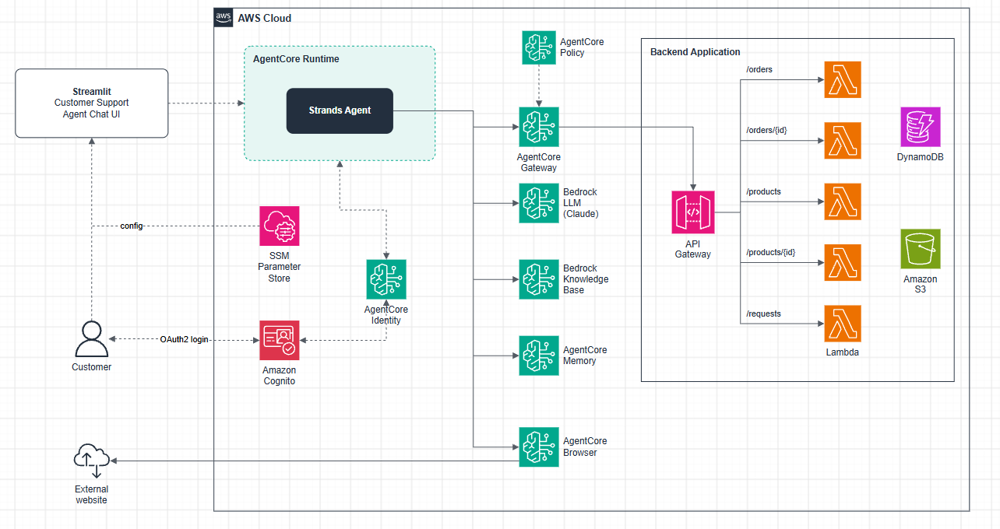
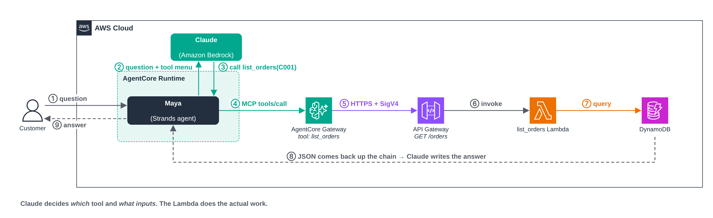
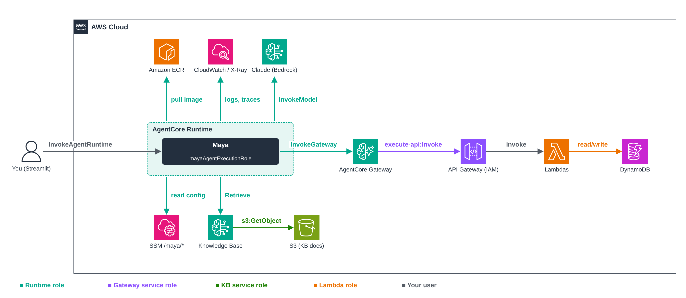

# AWS AI — Bedrock AgentCore

A hands-on project for building a real customer support agent on **Amazon Bedrock AgentCore**, one piece at a time.

The agent is **Maya**, a support assistant for a made-up online store called **ShopSmart**. She answers policy questions, looks up orders and products, tracks packages and opens return requests. She starts as a single Python file on a laptop. Each module moves one part of her onto a managed AgentCore service, until she's running the way you'd run an agent in production.

Maya is built with [Strands Agents](https://strandsagents.com) and uses Claude on Amazon Bedrock.

## The target architecture



> Editable source: [`01-agent-overview/images/agentcore-architecture.drawio`](01-agent-overview/images/agentcore-architecture.drawio)

| Piece | What it does for Maya |
|---|---|
| **AgentCore Runtime** | Hosts Maya as a container, giving each chat session its own isolated microVM |
| **Claude on Bedrock** | The model that reasons and decides which tool to use |
| **Knowledge Base** | ShopSmart's policies and FAQ, searched on demand |
| **AgentCore Gateway** | Turns the ShopSmart REST API into MCP tools Maya can call |
| **API Gateway + Lambda + DynamoDB** | The ShopSmart backend: orders, products and support requests |
| **AgentCore Memory** | Remembers the conversation and the customer across sessions |
| **AgentCore Identity + Cognito** | Knows who the customer is, and handles credentials for tools |
| **AgentCore Policy** | Rules on what Maya's tool calls are allowed to do |
| **AgentCore Browser** | Lets Maya check real carrier websites |
| **SSM Parameter Store** | One place for config (model ID, KB ID, endpoints), so nothing is hardcoded |
| **CloudWatch** | Logs and traces for every run |

## Modules

| Module | What you do | What changes for Maya |
|---|---|---|
| [00 — Setup](00-setup/README.md) | AWS identity, workstation, tooling | — |
| [01 — AgentCore Overview](01-agent-overview/README.md) | The architecture above, and why each piece is there | — |
| [02 — Build an Agent](02-build-an-agent/README.md) | Run Maya locally against Claude on Bedrock | Model + prompt + simulated tools, on your laptop |
| [03 — Deploy to AgentCore Runtime](03-agentcore-runtime/README.md) | Build an ARM64 image, push to ECR, create the runtime | Runs in AWS and is reachable from the Streamlit chat UI |
| [04 — Knowledge Base](04-knowledge-base/README.md) | Put policy docs in S3 and create a managed Knowledge Base | Policy answers come from documents, not the prompt |
| [05 — AgentCore Gateway](05-agentcore-gateway/README.md) | Deploy the ShopSmart backend and put Gateway in front of it | Orders and products are real, served as MCP tools |

More modules (Memory, Identity, Policy, Browser, Observability) follow the same pattern: change one thing, rebuild, redeploy.

## How a tool call works

This is the question everyone asks once Gateway is in the picture: *if the Lambda gets the orders, what is the "tool" doing?*



> Editable source: [`images/tool-call-flow.drawio`](images/tool-call-flow.drawio)

1. A customer asks *"Show me my orders, I'm C001."*
2. Maya (Strands) sends the question **plus a menu of tools** to Claude. The menu comes from the Gateway, which builds it from the OpenAPI spec: each tool has a name (`list_orders`), a description ("use when a customer asks about their order history") and its inputs (`customerId`).
3. Claude can't run code. It just replies, in effect, *"call `list_orders` with `customerId=C001`"*.
4. Strands sends that call to the Gateway over MCP.
5. The Gateway turns it into `GET /orders?customerId=C001`, signs it with SigV4 and calls API Gateway.
6. API Gateway invokes the `list_orders` Lambda...
7. ...which queries DynamoDB.
8. The JSON comes back up the chain to Claude.
9. Claude turns it into a friendly answer.

So **the Lambda does the work, and the tool is how Claude finds out the work exists and how to ask for it.** The tool's description is effectively part of the prompt, so writing it well is what makes Claude pick the right tool.

## Who needs which permissions



> Editable source: [`images/permissions.drawio`](images/permissions.drawio)

Every arrow is an IAM permission on the role making the call. Colours match the roles below.

### Maya's runtime role (`mayaAgentExecutionRole`)

Trusted by `bedrock-agentcore.amazonaws.com`.

| Needs to | Actions | On | Added in |
|---|---|---|---|
| Pull her image | `ecr:GetAuthorizationToken` (`*`), `ecr:BatchGetImage`, `ecr:GetDownloadUrlForLayer` | `repository/maya-agent` | 03 |
| Write logs | `logs:CreateLogGroup`, `logs:CreateLogStream`, `logs:PutLogEvents`, `logs:Describe*` | `/aws/bedrock-agentcore/runtimes/*` | 03 |
| Send traces and metrics | `xray:PutTraceSegments`, `xray:PutTelemetryRecords`, `xray:GetSampling*`, `cloudwatch:PutMetricData` | `*` | 03 |
| Call Claude | `bedrock:InvokeModel`, `bedrock:InvokeModelWithResponseStream` | the inference profile **and** the foundation models it routes to | 03 |
| Read config | `ssm:GetParametersByPath`, `ssm:GetParameter` | `parameter/maya` and `parameter/maya/*` | 03 |
| Search the Knowledge Base | `bedrock:Retrieve` | `knowledge-base/<kb-id>` | 04 |
| Call the Gateway | `bedrock-agentcore:InvokeGateway` | `gateway/<gateway-id>` | 05 |

### AgentCore Gateway service role

Trusted by `bedrock-agentcore.amazonaws.com`.

| Needs to | Actions | On |
|---|---|---|
| Call the ShopSmart API with SigV4 | `execute-api:Invoke` | `arn:aws:execute-api:<region>:<acct>:<api-id>/prod/*/*` |
| Read the OpenAPI spec (only if it's stored in S3) | `s3:GetObject` | the spec object |

### The other roles

| Role | Needs | Created by |
|---|---|---|
| **Knowledge Base service role** | `s3:GetObject`, `s3:ListBucket` on the docs bucket | The console, when you create the KB |
| **Lambda role** | DynamoDB read/write on the two tables, plus basic logs | The `shopsmart-backend` CloudFormation stack |
| **You / the Streamlit app** | `bedrock-agentcore:InvokeAgentRuntime` on the runtime, `ssm:GetParameter` on `/maya/runtime_arn` | Your own IAM user |

The runtime role's trust policy should be scoped with `aws:SourceAccount` and `aws:SourceArn` conditions, and so should the Gateway role's. Then only resources in your account can assume them.

## Repo layout

```text
aws-ai-bedrock-agentcore/
├── 00-setup/                 installer + setup guide
├── 01-agent-overview/        target architecture
├── 02-build-an-agent/        Maya, running locally
├── 03-agentcore-runtime/     Maya on AgentCore Runtime + Streamlit UI
├── 04-knowledge-base/        Maya + Knowledge Base
├── 05-agentcore-gateway/     Maya + Gateway (MCP tools), OpenAPI spec
├── shopsmart-backend/        CloudFormation, Lambdas, seed data, KB documents
├── images/                   diagrams used in this README
└── requirements.txt          Python deps for the UI and helper tools
```

Each module folder has its own `agent.py`, `Dockerfile` and `README.md`, so you can see exactly what changed from one step to the next.

## Before you start

- An AWS account with Bedrock access to Anthropic Claude, in **us-east-1**
- Python 3.11+, the AWS CLI v2, Docker, and Git
- On Windows: Docker Desktop and a **Git Bash** terminal in VS Code (run `export MSYS_NO_PATHCONV=1` first)

[00 — Setup](00-setup/README.md) walks through all of it.
